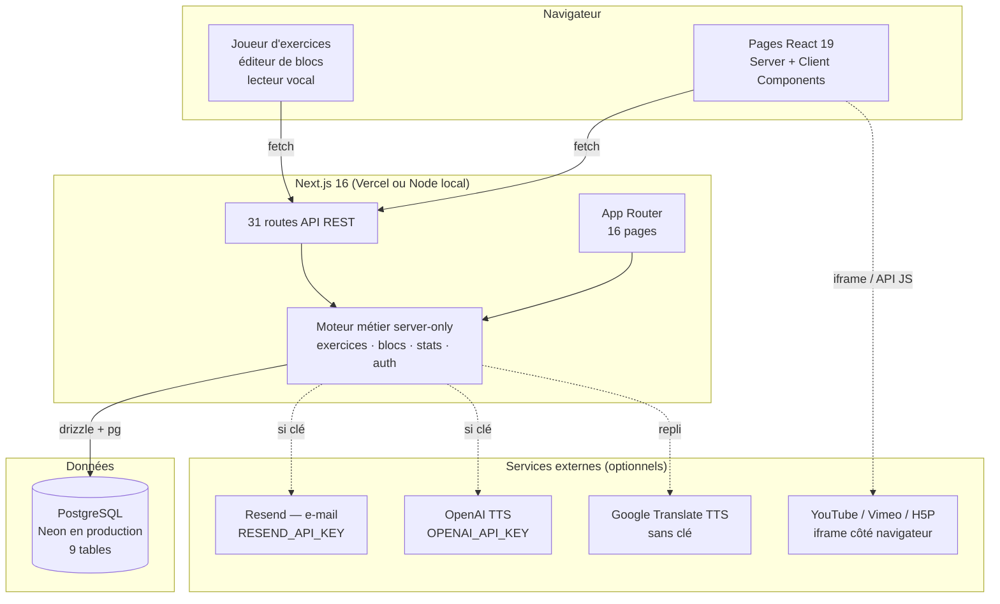
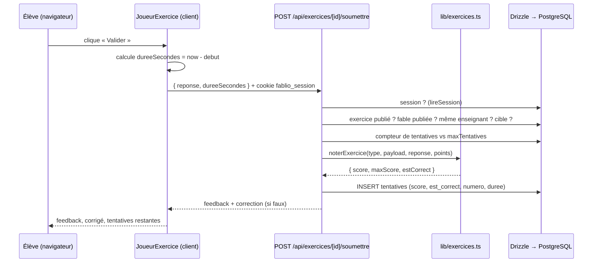
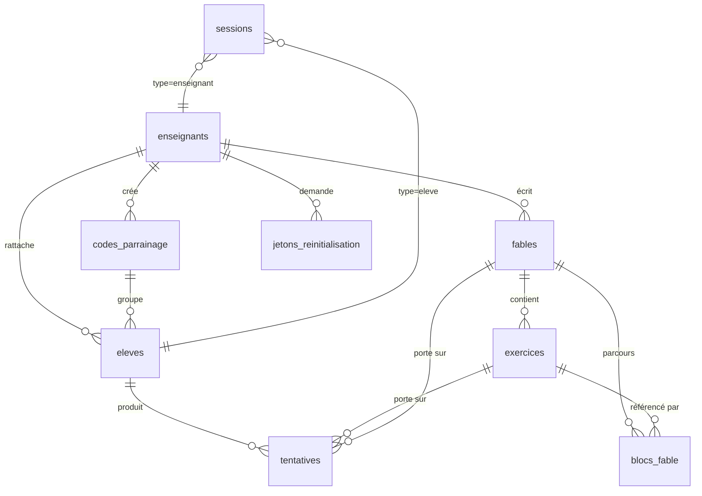
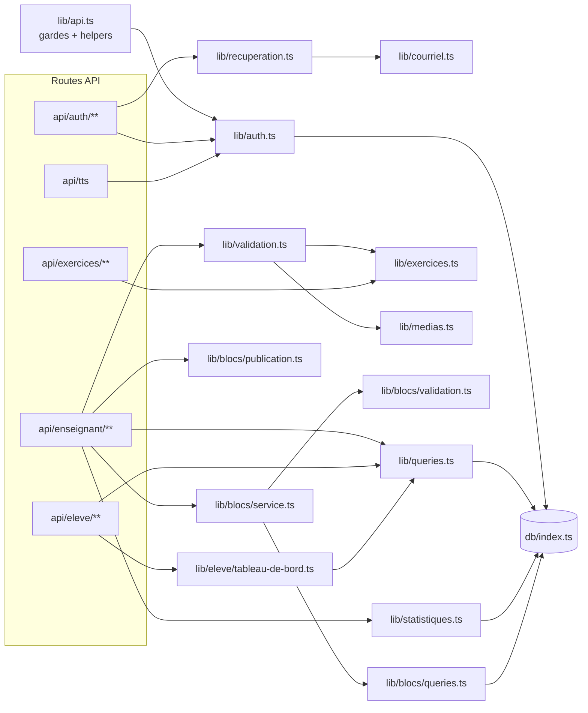

# Fablio — Architecture technique

> Document produit par reverse engineering du dépôt `hadil12345678952/fablio`
> (branche `main`, commit `b343227` — « FIX PASS RECOVERY »).
> Toutes les affirmations ci-dessous sont **vérifiées dans le code** ; celles qui
> reposent sur une observation à l'exécution sont marquées **[vérifié à l'exécution]**
> et celles qui restent incertaines sont marquées **[à confirmer]**.

---

## 1. Résumé du projet

Fablio est une plateforme web éducative francophone (école primaire, 7–10 ans) pour
l'apprentissage des fables. Deux rôles :

- **Enseignant** : crée des fables (texte, morale, illustration, audio, vidéo),
  compose des exercices de **8 types**, génère des **codes de parrainage** de classe,
  publie/dépublie les fables, corrige les réponses ouvertes, consulte des
  statistiques et exporte les résultats en CSV.
- **Élève** : rejoint une classe avec un **code de parrainage** + pseudo + code secret
  (PIN) — **sans e-mail**, lit la fable (texte, image, audio, vidéo, lecture à voix
  haute), fait les exercices, suit sa progression et ses badges.

Volumétrie du dépôt : **114 fichiers suivis**, **13 793 lignes** de TS/TSX
(`git ls-files '*.ts' '*.tsx' | xargs wc -l`),
**31 routes API** (fichiers `route.ts`) et **16 pages** (App Router), plus `/_not-found` et `/icon.svg` (vérifié par `find` et par la table du build).

---

## 2. Pile technique (vérifiée dans `package.json` et le code)

| Domaine | Technologie | Version | Preuve |
|---|---|---|---|
| Framework | **Next.js App Router** (Turbopack) | 16.2.6 | `package.json`, `next -p version` → 16.2.6 |
| UI | **React** | 19.2.6 | `package.json` |
| Langage | **TypeScript** strict | 5.9.3 | `tsconfig.json` (`"strict": true`) |
| Styles | **Tailwind CSS v4** (plugin PostCSS) | 4.1.17 | `postcss.config.mjs`, `src/app/globals.css` |
| ORM | **Drizzle ORM** + `node-postgres` | 0.45.2 / `pg` 8.20 | `src/db/index.ts`, `src/db/schema.ts` |
| Migrations | `drizzle-kit` + **script SQL idempotent** | 0.31.10 | `drizzle.config.ts`, `scripts/setup-db.mjs` |
| Authentification | Cookies httpOnly + **bcryptjs** | 3.x | `src/lib/auth.ts` |
| Graphiques | **Recharts** | 3.10.1 | `src/components/graphiques.tsx` |
| Icônes | **lucide-react** | 1.38 | partout dans `src/components` |
| Garde-fou serveur | `server-only` | 0.0.1 | `src/lib/auth.ts`, `src/db`… |
| Tests | *(aucun framework dans le dépôt)* | — | `package.json` : pas de script `test` |
| Verrouillage | *(aucun lockfile suivi)* | — | `git ls-files` : pas de `package-lock.json` |

Scripts npm déclarés : `dev`, `build`, `start`, `lint`, `typecheck` — **aucun `test`**.

---

## 3. Structure du dépôt

```
fablio/
├── drizzle.config.ts        Drizzle Kit (dialecte postgresql, schéma src/db/schema.ts)
├── next.config.ts           images distantes autorisées en http(s) (**)
├── eslint.config.mjs        ESLint 9 flat config + eslint-config-next/core-web-vitals
├── tsconfig.json            alias « @/* » → ./src/*
├── .env.example             inventaire des variables (aucune valeur secrète)
├── scripts/
│   ├── setup-db.mjs         DDL idempotent : 9 tables + index + contraintes
│   ├── migrer-blocs.mjs     migration ancien modèle → blocs (dry-run/execute/verify/rollback)
│   └── seed.mjs             données de démonstration (UUID déterministes)
├── src/
│   ├── app/                 App Router : pages + 31 routes API
│   │   ├── api/…            REST (voir docs/api-inventory.md)
│   │   ├── enseignant/…     tableau de bord, fables, éditeur, codes, élèves, stats
│   │   ├── eleve/…          bibliothèque, lecture de fable, profil
│   │   ├── connexion, inscription, mot-de-passe/{oublie,reinitialiser}
│   │   └── layout.tsx       polices (next/font/google), thème « papier/encre »
│   ├── components/          composants client (éditeurs, joueur, graphiques, TTS…)
│   ├── db/
│   │   ├── index.ts         Pool pg + drizzle (SSL auto, cache global du pool)
│   │   └── schema.ts        modèle de données (9 tables)
│   └── lib/
│       ├── auth.ts          sessions, bcrypt, lecture du cookie
│       ├── api.ts           helpers HTTP (`erreurJson`, gardes de rôle)
│       ├── exercices.ts     moteur d'exercices (payloads, mélange, notation, validation)
│       ├── medias.ts        normalisation images/vidéos/H5P
│       ├── validation.ts    validation des formulaires fable/exercice
│       ├── queries.ts       lectures métier partagées
│       ├── statistiques.ts  agrégations + export CSV
│       ├── recuperation.ts  jetons de réinitialisation (SHA-256)
│       ├── courriel.ts      envoi Resend **ou** journalisation serveur
│       ├── blocs/           moteur de parcours pédagogique par blocs
│       └── eleve/tableau-de-bord.ts  agrégats du tableau de bord élève
├── DEPLOIEMENT.md           manuel Vercel + Neon
├── MOODLE_REMOVAL.md        historique du retrait de Moodle
├── PLAN_EDITEUR_BLOCS.md    conception de l'éditeur de blocs
└── RECUPERATION.md          spécification de la récupération de mot de passe
```

(**) `next.config.ts` autorise **toutes** les images distantes http(s) :
`remotePatterns: [{ protocol: "https", hostname: "**" }, { protocol: "http", hostname: "**" }]`.
C'est un point de sécurité à connaître : l'optimiseur d'images devient un proxy
ouvert pour tout hôte (SSRF potentiel limité à l'optimiseur).

---

## 4. Architecture générale



### Flux d'une requête typique (exemple : soumission d'un exercice)



---

## 5. Architecture frontend

- **App Router** (React Server Components par défaut). Les pages serveur lisent la
  session via `lireSession()` et redirigent (`/connexion?role=…`) si besoin —
  **aucun middleware** `middleware.ts` n'existe dans le dépôt : le contrôle d'accès
  est fait page par page + dans chaque route API.
- **Composants client** (`"use client"`) pour l'interactivité : joueur d'exercices
  (759 l.), éditeur de blocs (744 l.), gestion des exercices (1 316 l.), formulaires
  d'authentification, lecteur vocal, graphiques Recharts, activités H5P, vidéo
  interactive.
- **État** : `useState`/`useReducer` locaux + `router.refresh()` après mutation ;
  aucun gestionnaire d'état global (pas de Redux/Zustand/Context applicatif).
- **Styles** : Tailwind v4 avec thème personnalisé (`bg-papier`, `text-encre`,
  `font-titre`, animations `anim-*`) défini dans `src/app/globals.css`.
- **Polices** : `next/font/google` — Baloo 2 (titres), Nunito (corps), Literata
  (lecture) — **nécessite un accès réseau au build** (voir `replication-status.md`).
- **Composants partagés** : `TexteRiche` (rendu Markdown minimal), `graphiques.tsx`
  (courbes/barres Recharts), `badges.tsx` (7 badges élève), `nav-*.tsx`.
- **Surface réseau client** (appels `fetch` repérés dans les composants) :

| Composant | Appels |
|---|---|
| `auth/formulaires-auth.tsx` | `/api/auth/{enseignant,eleve}/{connexion,inscription}` |
| `auth/formulaires-mot-de-passe.tsx` | `/api/auth/mot-de-passe/{demande,reinitialiser}` (GET+POST) |
| `deconnexion.tsx` | `POST /api/auth/deconnexion` |
| `blocs/editeur-pedagogique.tsx` | 6 appels : blocs (GET/POST), bloc (PUT/DELETE), `deplacer`, `dupliquer` |
| `enseignant/actions-fable.tsx` | `PUT` (publication) et `DELETE /api/enseignant/fables/[id]` |
| `enseignant/formulaire-fable.tsx` | `POST/PUT /api/enseignant/fables[/id]` |
| `enseignant/gestion-codes.tsx` | `POST /api/enseignant/codes`, `PATCH`/`DELETE /codes/[id]` |
| `enseignant/gestion-exercices.tsx` | `POST/PUT/DELETE exercices`, `PUT …/ordre-exercices` |
| `enseignant/reinitialiser-pin.tsx` | `PATCH /api/enseignant/stats/eleves/[id]` |
| `enseignant/statistiques-clients.tsx` | `PATCH /api/enseignant/reponses/[id]` |
| `exercice/joueur-exercice.tsx` | `POST /api/exercices/[id]/soumettre` |
| `lecteur-vocal.tsx` | `POST /api/tts` |

---

## 6. Architecture backend

- **Routes API** = fonctions `GET/POST/PUT/PATCH/DELETE` exportées par des
  `route.ts` (App Router). Pas de contrôleur partagé : chaque route fait ses
  vérifications puis appelle `src/lib/**`.
- **Gardes de rôle** (`src/lib/api.ts`) : `enseignantConnecte()` / `eleveConnecte()`
  renvoient soit l'entité, soit une réponse `401 { erreur }` — motif
  `if ("echec" in auth) return auth.echec;` dans toutes les routes protégées.
- **Validation** en deux niveaux :
  1. *formulaires* (`src/lib/validation.ts`) — longueurs, plages, URL normalisées ;
  2. *payloads d'exercice* (`validerPayload`, `src/lib/exercices.ts`) — règles par type.
- **Erreurs** : toujours un JSON `{ erreur: string }` avec le code approprié
  (400 validation, 401 non authentifié, 403 non autorisé/limite atteinte,
  404 ressource absente **ou appartenant à un autre enseignant**, 409 conflit, 500, 502 fournisseur externe).
  Les erreurs non prévues remontent en 500 (page `error.tsx` côté UI).
- **Transactions** : utilisées pour les opérations de blocs (verrous `FOR UPDATE`,
  renumérotation, contrôles d'invariant) et pour la réinitialisation de mot de passe
  (mot de passe + jeton + suppression des sessions).
- **Cache** : pool `pg` mis en cache sur `globalThis` (réutilisation entre
  invocations chaudes, sécurité vis-à-vis du HMR) ; pages rendues dynamiquement
  (`ƒ` dans la sortie de build) ; `/api/tts` répond avec
  `Cache-Control: private, max-age=3600`. Pas de cache HTTP applicatif ni de
  revalidation Next.
- **Tâches asynchrones / planifiées / webhooks** : **aucun** cron, aucune file,
  aucun webhook entrant. Les seuls appels sortants sont Resend, OpenAI et Google
  Translate TTS (voir `docs/api-inventory.md`).

---

## 7. Base de données et modèle de données

`src/db/index.ts` : le `DATABASE_URL` est **obligatoire** (sinon
`throw new Error("DATABASE_URL is required")` — vérifié : toutes les routes
retournent alors 500 et le journal serveur porte ce message). SSL activé
automatiquement si l'URL contient `sslmode=require|verify` ou l'hôte
`neon.tech|supabase.|render.com|aivencloud.com`, ou si `PGSSL=1`. Taille du pool
`PG_POOL_MAX` (défaut **5**), `idleTimeoutMillis` 30 s, `connectionTimeoutMillis` 15 s.



| Table | Rôle | Points notables |
|---|---|---|
| `enseignants` | compte enseignant | `email` UNIQUE, `mot_de_passe_hash` (bcrypt, 60 car. `$2b$10$` — vérifié en base) |
| `codes_parrainage` | codes de classe | `code` UNIQUE (format `BASE-XXXXX`), `etiquette`, `actif` |
| `eleves` | comptes élèves | UNIQUE `(enseignant_id, pseudo)`; `code_id` → `SET NULL` si le code est supprimé ; `pin_hash` bcrypt |
| `fables` | fables | `cible_code_ids` **jsonb** : `[]` = visible par tous les élèves de l'enseignant ; `publie` ; `difficulte` |
| `exercices` | exercices | `payload` jsonb **typé par `type`** (8 types), `points`, `ordre`, `publie`, `max_tentatives` (`null` = illimité) |
| `tentatives` | réponses des élèves | `score`/`est_correct` **nullables** = en attente de correction manuelle ; `numero` ; `duree_secondes` ; `corrige_le` |
| `blocs_fable` | parcours pédagogique | `type` ∈ {texte,image,audio,video,exercice} ; `ordre` contigu 0..n-1 ; `contenu` jsonb ; **colonne dédiée** `exercice_id` |
| `jetons_reinitialisation` | reset mot de passe | `jeton_hash` SHA-256 UNIQUE (jamais le jeton en clair), `expire_le`, `utilise_le` |
| `sessions` | sessions | `token` (32 octets hex) en clé primaire, `type_utilisateur`, `expire_le` |

Règles de suppression (DDL du dépôt) : `ON DELETE CASCADE` de `enseignants` vers
ses codes/élèves/fables/jetons/sessions ; de `fables` vers `exercices`/`blocs`/`tentatives` ;
de `exercices` vers `tentatives` **et** `blocs_fable.exercice_id` ; `eleves.code_id`
en `SET NULL`.

> Schéma déployé = **9 tables** (`setup-db.mjs` et `schema.ts` sont alignés — vérifié :
> `select table_name` → `blocs_fable, codes_parrainage, eleves, enseignants, exercices,
> fables, jetons_reinitialisation, sessions, tentatives`). Le `README.md` annonce
> « 7 tables » : **documentation légèrement obsolète**.

---

## 8. Dépendances entre modules



`lib/exercices.ts` et `lib/medias.ts` sont **purs** (aucun import serveur) : ils
sont utilisés à la fois par le serveur (notation, validation) et par le client
(mélanges d'affichage, éditeurs).

---

## 9. Ce qui est confirmé / ce qui reste à vérifier

**Confirmé par le code et l'exécution** : pile et versions ; 31 routes API ;
9 tables ; sessions par cookie httpOnly ; notation à quart de point ; quotas et
validations ; repli historique des blocs ; export CSV ; plantage explicite sans
`DATABASE_URL`. À noter pour les tests : les pages privées sont protégées par un
`redirect()` de layout **serveur**, mais avec le rendu en flux de Next 16 la réponse
est un **200** ne contenant aucune donnée privée (seul le `<title>`), suivi d'un
`<meta http-equiv="refresh" content="1;url=/connexion?role=…">` (digest
`NEXT_REDIRECT … 307`) — le navigateur redirige, mais un client HTTP ne voit pas de
307 (vérifié).

**Confirmé par le code seulement (non exécutable ici)** : appels Resend et OpenAI
TTS (clés absentes), envoi réel d'e-mails, lecture audio Google Translate
(réseau bloqué dans l'environnement d'analyse).

**À confirmer par le propriétaire du projet** :
- le paramétrage exact de Vercel (nom du projet, domaine, variables réellement
  définies en production) ;
- l'existence/le contenu du bucket d'images : le dépôt **ne contient pas de dossier
  `public/`**, alors que la page d'accueil référence `/images/hero-livre-magique.png`
  et que le seed référence `/images/fables/*.jpg` **[vérifié à l'exécution : ces
  chemins renvoient 404 dans la reproduction]** ;
- la présence d'éventuelles tables Moodle résiduelles en production
  (`MOODLE_REMOVAL.md` en décrit le retrait).
